# quant-research-framework

[](https://github.com/AimanxxAnsari/quant-research-framework/actions/workflows/ci.yml)

**A cross-asset quant research framework built on a point-in-time, reproducible data foundation.**

An independent quant research project covering rates, FX, equity, commodity and volatility data:
statistics, energy-futures term structure, a backtesting engine with overfitting controls,
synthetic-data validation, relative value and statistical arbitrage, systematic strategies, risk
(VaR / ES / EVT / copulas), portfolio construction and yield-curve models, volatility forecasting
and regime models. Every number is meant to be traceable to raw data, code and assumptions.

## Roadmap

| Pillar | Topic | Progress |
|---|---|---|
| 0 | Data foundation: collectors, immutable raw store, clean tables, quality checks | Built |
| 2 | Returns, volatility estimators, distributions, correlation and non-synchronous data, variance ratio, Hurst | Built |
| 3 | Energy futures: contract mapping, roll engine, curves, convenience yield, Schwartz-Smith | Planned |
| 4 | Backtesting engine, costs, walk-forward, purged CV, Deflated Sharpe, PBO | In progress: engines and validation tools built and tested ([design](docs/design/backtester.md)); study next |
| 5 | Synthetic data and known-answer tests: how often methods fool you | Built |
| 6 | Pairs, cointegration, Kalman hedge ratios, PCA statistical arbitrage | Planned |
| 7 | Trend, carry, cross-sectional momentum, FX forward-premium regression | Planned |
| 9 | Risk engine: VaR / ES, backtests, stress tests, EVT, copulas | Planned |
| 10 | Portfolio construction, factor models, yield-curve PCA, Nelson-Siegel-Svensson, short-rate models | Planned |
| 11 | Volatility clustering, GARCH family, HAR-RV, variance risk premium | Planned |
| 12 | Forecast ledger and calibration | Planned |
| 13 | Regime models: HMM, Markov switching, change points | Planned |

## Pillar 0: data foundation

```
collectors (FRED, Treasury, French, Tiingo)
        |  HTTP with retries; secrets in .env, redacted from every log and manifest
        v
data/raw/   immutable snapshots: <source>/<dataset>/<time>_<sha12>.<ext> + manifest.jsonl
        |  latest snapshot per dataset, parsed by pure functions
        v
data/clean/ observations.parquet | prices.parquet | series.parquet  + warehouse.duckdb (views)
        |
        v
quality checks: coverage, uniqueness, missing values, plausible ranges, OHLC consistency,
                jumps, freshness  ->  data/health.md, non-zero exit on any FAIL
```

| Source | Content | Coverage at first build |
|---|---|---|
| FRED | 37 series: Treasury constant-maturity yields, fed funds, SOFR, real yield, breakeven, VIX / OVX / GVZ, 9 H.10 FX rates, WTI and Brent spot, CPI, unemployment, and short rates for 10 currencies (daily for USD, EUR, GBP; monthly OECD averages for the rest) | from 1947 (series-dependent) to the latest release |
| US Treasury | Daily par nominal (from 1990) and real (from 2003) yield curves, 19 tenors | 1990 to latest |
| Kenneth French library | Daily Fama-French 3 factors and momentum | collector built; download currently blocked (HTTP 403), see devlog |
| Tiingo | 33 ETFs across US and international equity, sectors, bonds, commodities, FX; raw and adjusted OHLCV | 2000 to latest |

Design: [`docs/design/data-foundation.md`](docs/design/data-foundation.md).
Decisions: [`docs/decisions/`](docs/decisions/).

**Data is never committed.** Raw vendor data and derived tables stay local
([ADR-0002](docs/decisions/ADR-0002-data-licensing.md)); the repository holds code, configuration,
tests on synthetic payloads, and documentation.

## Pillar 2: statistics toolkit

Modules in `quant_research.stats`: `returns` (simple/log, CAGR, drawdowns), `volatility`
(close-to-close, EWMA, Parkinson, Garman-Klass, Rogers-Satchell, Yang-Zhang), `distribution`
(moments, Jarque-Bera, tail frequency), `dependence` (beta, rolling correlation, lead-lag,
non-synchronous correction), `random_walk` (Lo-MacKinlay variance ratio with robust z*, R/S Hurst
with shuffled baseline, Lo's modified R/S). Every function has a known-answer test on simulated
data. Cross-asset monitor: `uv run qrf monitor`.

## Pillar 2 results

<!-- PILLAR2:START -->
<!-- Generated by `qrf study`. Do not edit by hand. -->

Data through 2026-11-20. Regenerate with `uv run qrf study pillar2`.

### Fat tails everywhere

| series | years | ann. vol | skew | excess kurtosis | 4-sd days per 100k | normal: per 100k |
|---|---|---|---|---|---|---|
| SPY | 26.8 | 19.3% | -0.21 | 11.5 | 636 | 6.3 |
| TLT | 24.3 | 14.2% | -0.02 | 3.4 | 261 | 6.3 |
| GLD | 22.0 | 18.4% | -0.45 | 6.5 | 397 | 6.3 |
| USO | 20.6 | 37.6% | -0.98 | 12.5 | 424 | 6.3 |
| EEM | 23.6 | 27.1% | 0.01 | 15.4 | 740 | 6.3 |
| EUR (USD per EUR) | 27.7 | 9.1% | 0.11 | 2.5 | 229 | 6.3 |
| JPY (USD per JPY) | 55.6 | 10.1% | 0.66 | 9.1 | 550 | 6.3 |
| UST 10Y yield change | 64.3 | 1.0% | -0.25 | 9.1 | 660 | 6.3 |

Every series has 36 to 117 times as many 4-standard-deviation days
as a normal distribution would produce. Negatively skewed: SPY, GLD, USO, UST 10Y yield change.

### Volatility estimators

| estimator (SPY, 21-day) | mean ann. vol | corr with next-month realised | RMSE of log ratio |
|---|---|---|---|
| close_to_close | 0.162 | 0.643 | 0.431 |
| ewma | 0.165 | 0.648 | 0.405 |
| parkinson | 0.135 | 0.672 | 0.425 |
| garman_klass | 0.136 | 0.672 | 0.421 |
| rogers_satchell | 0.137 | 0.672 | 0.422 |
| yang_zhang | 0.166 | 0.661 | 0.404 |

<picture><source media="(prefers-color-scheme: dark)" srcset="reports/pillar2/figures/spy_vol_estimators-dark.png">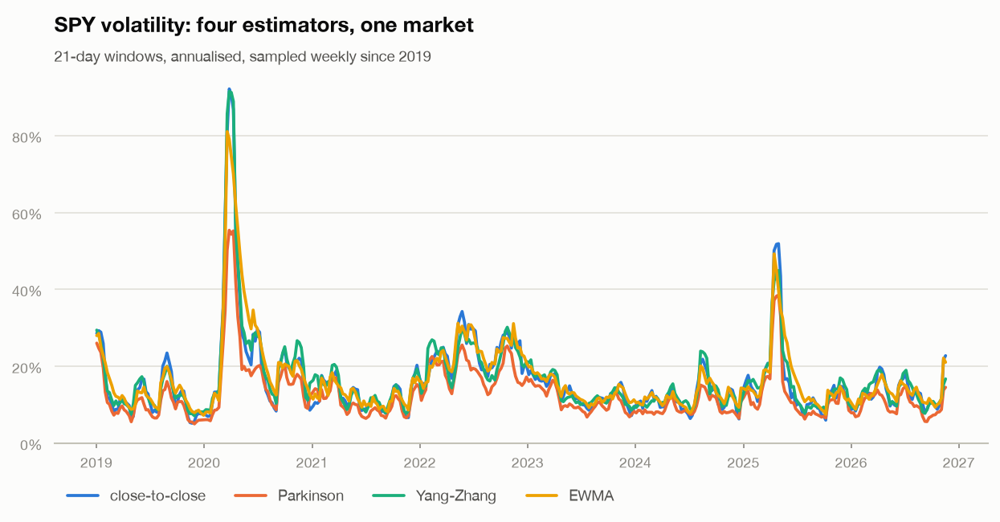</picture>

Parkinson, Garman-Klass and Rogers-Satchell use only the trading session, so they read lower
than close-to-close (16.2%) by missing overnight gaps; Yang-Zhang adds the gap
back. As predictors of the next month's realised volatility, **garman_klass** has the highest
correlation and **yang_zhang** the smallest error, versus 0.64
correlation for close-to-close.

### Non-synchronous data: noon FX fixings vs a 4 pm equity close

| SPY (4 pm close) vs | daily corr | corr(SPY_t, X_t+1) | corr(SPY_t, X_t-1) | lag-corrected daily | weekly corr | days |
|---|---|---|---|---|---|---|
| EWJ (NY close, control) | 0.702 | -0.097 | -0.058 | 0.547 | 0.653 | 6701 |
| EUR (noon NY fix) | 0.093 | 0.090 | -0.014 | 0.168 | 0.171 | 6701 |
| JPY (noon NY fix) | -0.161 | -0.015 | 0.008 | -0.168 | -0.168 | 6701 |
| AUD (noon NY fix) | 0.269 | 0.218 | -0.021 | 0.466 | 0.468 | 6701 |

<picture><source media="(prefers-color-scheme: dark)" srcset="reports/pillar2/figures/spy_aud_lead_lag-dark.png">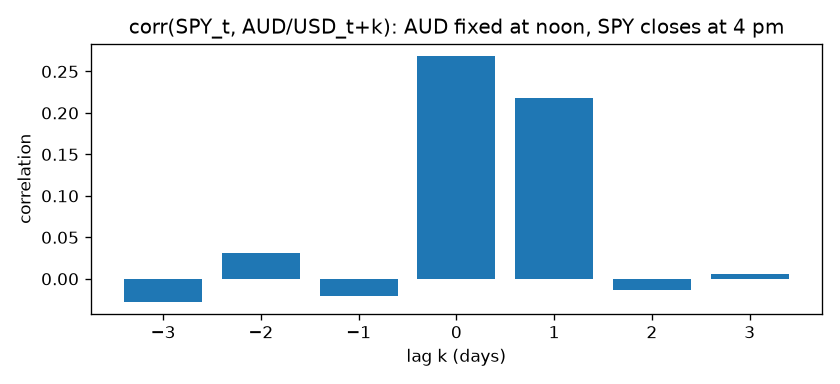</picture>

FRED's H.10 FX rates are fixed at noon New York, four hours before SPY closes, so part of SPY's
afternoon move can only appear in the next day's fixing.

- **EWJ (NY close, control):** daily 0.70, next-day -0.10 (significant negative next-day correlation, i.e. partial reversal); lag-corrected 0.55 vs weekly 0.65.
- **EUR (noon NY fix):** daily 0.09, next-day 0.09 (significant positive next-day spillover); lag-corrected 0.17 vs weekly 0.17.
- **JPY (noon NY fix):** daily -0.16, next-day -0.01 (no detectable next-day effect); lag-corrected -0.17 vs weekly -0.17.
- **AUD (noon NY fix):** daily 0.27, next-day 0.22 (significant positive next-day spillover); lag-corrected 0.47 vs weekly 0.47.

Where the spillover exists, summing lagged covariances recovers almost exactly the weekly
correlation, and daily correlation understates the link. EWJ trades in New York alongside SPY but
holds Japanese stocks whose market is closed then; its small negative next-day correlation is
consistent with partial reversal of US-session moves, so it is not a perfectly clean control.
Significance threshold: |corr| above 3/sqrt(days), about three standard errors.

### Random-walk tests: variance ratios (Lo & MacKinlay 1988)

| weekly log returns | VR(2) | VR(4) | VR(8) | VR(16) |
|---|---|---|---|---|
| SPY | 0.96 | 0.93 | 0.89 | 0.85 |
| EFA | 0.94 | 0.93 | 0.93 | 0.95 |
| EEM | 0.92 | 0.90 | 0.93 | 0.98 |
| TLT | 0.96 | 0.98 | 1.00 | 0.99 |
| IEF | 1.00 | 1.03 | 1.06 | 1.03 |
| GLD | 0.95 | 0.93 | 0.84 | 0.81 |
| USO | 1.05 | 1.11 | 1.29 | 1.54 |
| HYG | 1.01 | 1.05 | 1.01 | 0.88 |
| EUR | 1.00 | 1.00 | 1.04 | 1.06 |
| JPY | 1.04 | 1.13 (sig.) | 1.22 (sig.) | 1.33 (sig.) |
| AUD | 0.98 | 0.96 | 1.00 | 1.03 |

VR(q) above 1 indicates trending, below 1 mean reversion. "(sig.)" marks ratios significant at 5%
using the heteroskedasticity-robust z* **after Holm correction across all 44 tests**.
Significant after correction: JPY
(3 of 44 tests). Most weekly return series are statistically
indistinguishable from a random walk once the number of tests is accounted for.

### Long memory? Hurst exponent vs Lo's modified R/S

| daily log returns | R/S Hurst | shuffled baseline | baseline sd | Lo V | Lo rejects no long memory |
|---|---|---|---|---|---|
| SPY | 0.529 | 0.538 | 0.019 | 1.409 | no |
| TLT | 0.530 | 0.540 | 0.018 | 1.169 | no |
| GLD | 0.550 | 0.537 | 0.022 | 1.419 | no |
| USO | 0.606 | 0.538 | 0.019 | 1.877 | yes |
| EUR | 0.566 | 0.535 | 0.016 | 1.411 | no |

The classical R/S Hurst exponent is above 0.5 even on shuffled data (small-sample bias), so it is
read against that baseline. Lo's modified R/S statistic, robust to short-range dependence, rejects
"no long memory" (outside [0.809, 1.862]) for: USO
(1 of 5 tests at 5%, uncorrected). With 5 independent tests, the
chance of at least one false rejection is 23%, so a single rejection is weak
evidence of long memory.

### Cross-asset correlation

<picture><source media="(prefers-color-scheme: dark)" srcset="reports/pillar2/figures/correlation_matrix-dark.png">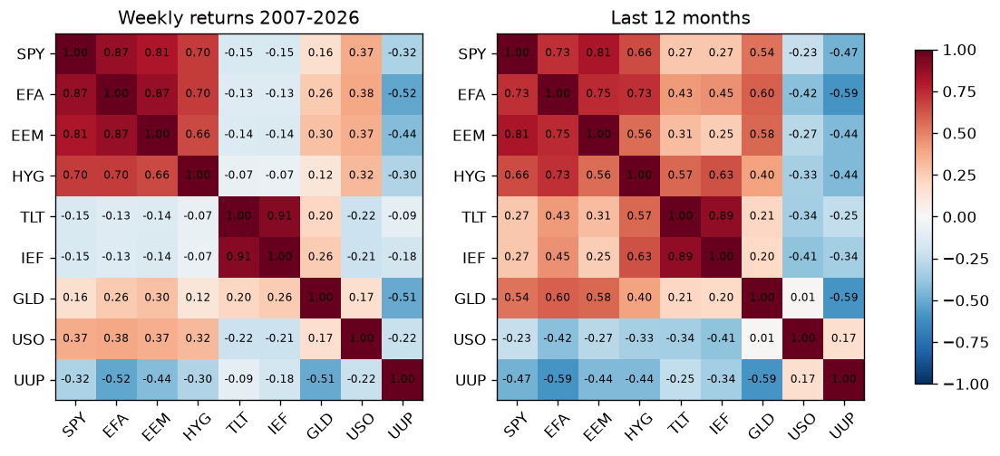</picture>

Stock-bond correlation (SPY vs TLT, weekly): -0.15 over the full sample
vs 0.27 in the last 12 months. Correlations are unstable; a hedge
that worked historically can stop working, which is why later pillars estimate them on rolling
windows and stress them.

<!-- PILLAR2:END -->

## Pillar 5: synthetic data and known-answer tests

Generators with known parameters in `quant_research.validation.synthetic` (GBM, Ornstein-Uhlenbeck,
GARCH(1,1) with Student-t innovations, cointegrated pairs, independent random walks, Markov
regime switching), estimators in `stats.mean_reversion` (AR(1) half-life, Engle-Granger), VaR
forecasts and the Kupiec test in `risk.var`, and overfitting tools in `validation.overfitting`
(expected maximum Sharpe, look-ahead-free moving-average crossover).

## Pillar 5 results

<!-- PILLAR5:START -->
<!-- Generated by `qrf study`. Do not edit by hand. -->

Pure simulation with fixed seeds; regenerate with `uv run qrf study pillar5`. Every row below
uses data where the right answer is known.

### How often do standard methods fool you?

| test or estimator | truth / nominal | measured |
|---|---|---|
| Engle-Granger test, unrelated random walks | 5.0% | 3.2% |
| Naive levels t-test, unrelated random walks | 5.0% | 89.8% |
| Variance ratio z (homoskedastic), GARCH data | 5.0% | 24.8% |
| Variance ratio z* (robust), GARCH data | 5.0% | 5.6% |
| 99% VaR, EWMA + normal, fat-tailed data | 1.0% | 1.9% |
| Half-life estimate, 250 days, true 10 | 10.0 | 8.2 (median) |
| Best of 100 no-skill strategies, 10y Sharpe | 0.00 | 0.78 |

### Mean reversion: half-lives are underestimated in short samples

| sample (true half-life 10) | median estimate | 5th pct | 95th pct | share below truth |
|---|---|---|---|---|
| 125 days | 7.2 | 3.4 | 15.7 | 77% |
| 250 days | 8.2 | 4.5 | 14.0 | 73% |
| 500 days | 9.1 | 6.0 | 13.9 | 65% |
| 1000 days | 9.5 | 7.4 | 12.7 | 61% |
| 2500 days | 9.9 | 8.2 | 11.9 | 53% |

<picture><source media="(prefers-color-scheme: dark)" srcset="reports/pillar5/figures/half_life_bias-dark.png">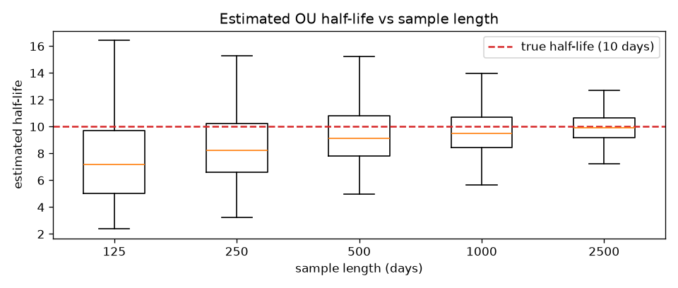</picture>

OLS on an AR(1) is biased towards faster mean reversion (Kendall 1954). With one year of data
the median estimate is 8.2 days for a true 10, and the
90% range spans 4.5 to 14.0 days.

### Cointegration: spurious relationships and screening

- Regressing one unrelated random walk on another: the naive t-test calls the slope significant
  in **89.8%** of cases (should be 5%), with median R-squared
  0.19 (Granger & Newbold 1974).
- The Engle-Granger residual test does not over-reject: **3.2%** false
  positives at a 5% level.
- Power on a true pair (500 days, hedge ratio 1.5): **98.2%** with a 10-day
  half-life, **12.5%** with a 50-day half-life.
- Screening 190 candidate pairs built from 20 unrelated random walks finds
  **10.4** "cointegrated" pairs on average, all false. Any pairs screen
  must report how many pairs were tested (5.5% of
  pairs pass at a 5% level, as expected when no relationship exists).

### Volatility clustering breaks naive test statistics

| rejection rate at 5%, VR(2) | homoskedastic z | robust z* |
|---|---|---|
| iid normal | 3.0% | 3.2% |
| GARCH(1,1) | 24.8% | 5.6% |

On returns with GARCH volatility clustering the homoskedastic variance-ratio statistic rejects
a true random walk far too often; the robust z* (used in Pillar 2) stays close to 5%.

### 99% Value at Risk on fat-tailed, clustered returns

| 99% VaR method on GARCH-t data | mean breach rate (target 1%) | Kupiec rejects at 5% |
|---|---|---|
| true conditional vol (t quantile) | 1.0% | 2.0% |
| EWMA + normal quantile | 1.9% | 100.0% |
| historical 250-day | 1.5% | 72.0% |

<picture><source media="(prefers-color-scheme: dark)" srcset="reports/pillar5/figures/var_breach_rates-dark.png">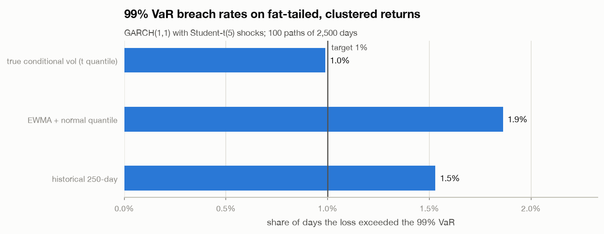</picture>

Knowing the true volatility and tail shape gives the right breach rate. A normal quantile on
Student-t returns under-reserves, and a slow historical window reacts late to volatility
clusters. Pillar 9 extends this with conditional-coverage tests and Expected Shortfall.

### Backtest overfitting: the best of many no-skill strategies

| no-skill strategies, 10 years each | best in-sample Sharpe (simulated) | theory E[max] |
|---|---|---|
| 1 strategy | -0.01 | 0.00 |
| 10 strategies | 0.49 | 0.50 |
| 100 strategies | 0.78 | 0.80 |
| 1000 strategies | 1.02 | 1.03 |

<picture><source media="(prefers-color-scheme: dark)" srcset="reports/pillar5/figures/max_sharpe_vs_trials-dark.png">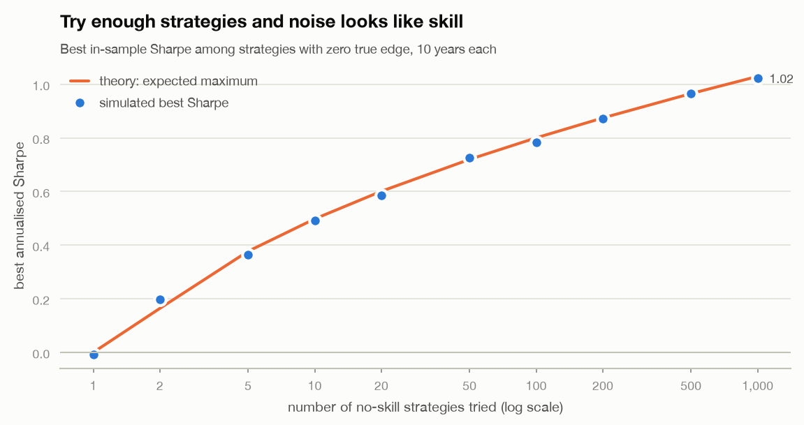</picture>

Trying more strategies on noise mechanically raises the best Sharpe ratio, closely matching the
Bailey & Lopez de Prado formula. A grid of 25 moving-average crossover rules
on a driftless random walk produced a best in-sample Sharpe of **0.41** and an
out-of-sample Sharpe of **-0.07** for the selected rule. Because the rules are highly
correlated, the in-sample maximum is below the independent-trials benchmark
(0.63); the effective number of trials is smaller than the grid size.
Pillar 4 uses this benchmark in the Deflated Sharpe Ratio.

<!-- PILLAR5:END -->

## Pillar 4: do popular trading rules survive overfitting correction?

2,364 pre-registered trials: 14 rule families (seven popular indicator strategies and the
classic academic rules) on 33 ETFs and 9 currencies, judged against buy-and-hold (ETFs) or cash
(currencies) with realistic timing and costs, then corrected for the search with SPA, StepM,
BHY haircuts, the Deflated Sharpe Ratio, PBO, walk-forward and CPCV.

<!-- PILLAR4:START -->
<!-- Generated by `qrf study`. Do not edit by hand. -->

Development period only (each asset from its start to 2021-11-30); the holdout is
still sealed. Data through 2026-11-23; generated by commit
`aa0d3f2` with `uv run qrf study pillar4`. Results use live vendor data, so
they reproduce with your own free keys and will shift slightly as data is revised. Plan and
deviations: [pre-registration](docs/projects/pillar-4/PREREGISTRATION.md). Every trial:
[`trials.csv`](reports/pillar4/development/trials.csv).

| Test | Question | Result | Outcome |
|---|---|---|---|
| H1 | Does any trial beat its benchmark, allowing for the search? (SPA p-value) | ETFs 0.98, FX 0.30, all 0.95 | 'no trial beats its benchmark' not rejected |
| H2 | Which trials survive? (StepM; BHY haircut) | StepM 0; BHY 0 of 2,364 | none survive |
| H3 | Is the best trial more than luck? (Deflated Sharpe) | ETF 0.73, FX 0.85 | below 0.95 for both |
| H4 | Does the in-sample best stay above the median out of sample? (median PBO) | ETFs 0.46, FX 0.46 | PBO above 0.5 for 19 of 42 assets |
| H5 | Does re-picking the best rule so far beat the benchmark out of sample? | positive for 18% of ETFs, 78% of FX | see per-asset chart |
| H6 | Share of trials beating the benchmark after costs (1x) | ETFs 16%, FX 66% | see cost chart |


**What the numbers say.** The best ETF trial, `UNG|RSI|period=14,lower=30,upper=70`, has an active Sharpe ratio
of 0.65, against a luck threshold of 0.49
for 12 effective trials: DSR 0.73
(0.11 if all 2,013 trials count as independent).
The best currency trial, `NZD|filter rule|x=0.05`, reaches 0.49: DSR
0.85 (0.28 with all 351 trials).

**Where "winning" comes from.** Across ETFs, the share of rules beating buy-and-hold has a
correlation of -0.85 with the ETF's own buy-and-hold return. The 6 ETFs that
lost money when held (GDX, USO, UNG, DBC, DBA, FXE) see 68% of their rules beat them, against
5% for the rest: being out of the market some of the time beats holding an ETF that lost money, without any timing skill.

**Currencies.** 66% of currency trials beat cash, and the families with a positive
median are MA crossover, channel breakout, price vs MA, time-series momentum, filter rule. But the SPA p-value for currencies is 0.30: within what the search alone produces.

**Costs.** The worst trial, `SHY|stochastic oscillator|n=14`, has an active Sharpe of -2.78 with
costs and -0.61 without; most of that gap is costs: frequent trading at a fixed cost on a quiet ETF.


<picture><source media="(prefers-color-scheme: dark)" srcset="reports/pillar4/development/figures/family_active_sharpe-dark.png">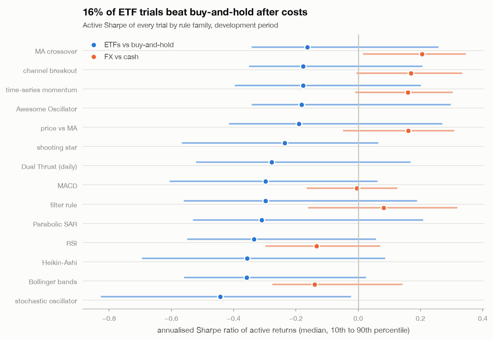</picture>

<picture><source media="(prefers-color-scheme: dark)" srcset="reports/pillar4/development/figures/buyhold_vs_rules-dark.png">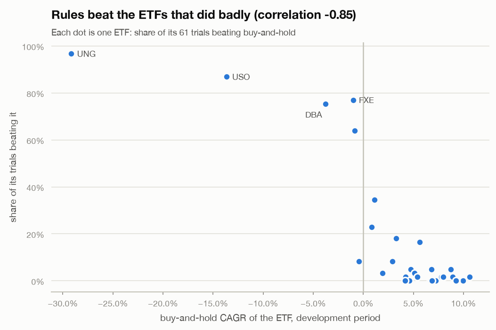</picture>

<picture><source media="(prefers-color-scheme: dark)" srcset="reports/pillar4/development/figures/in_vs_out_of_sample-dark.png">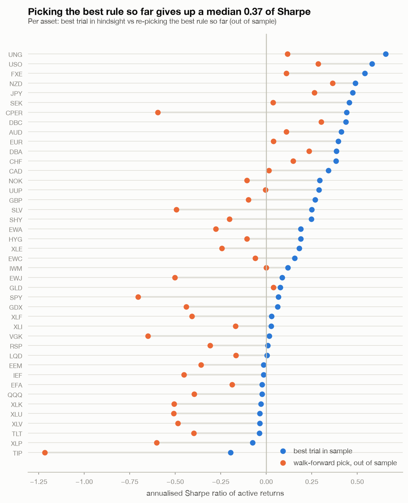</picture>

<picture><source media="(prefers-color-scheme: dark)" srcset="reports/pillar4/development/figures/costs-dark.png">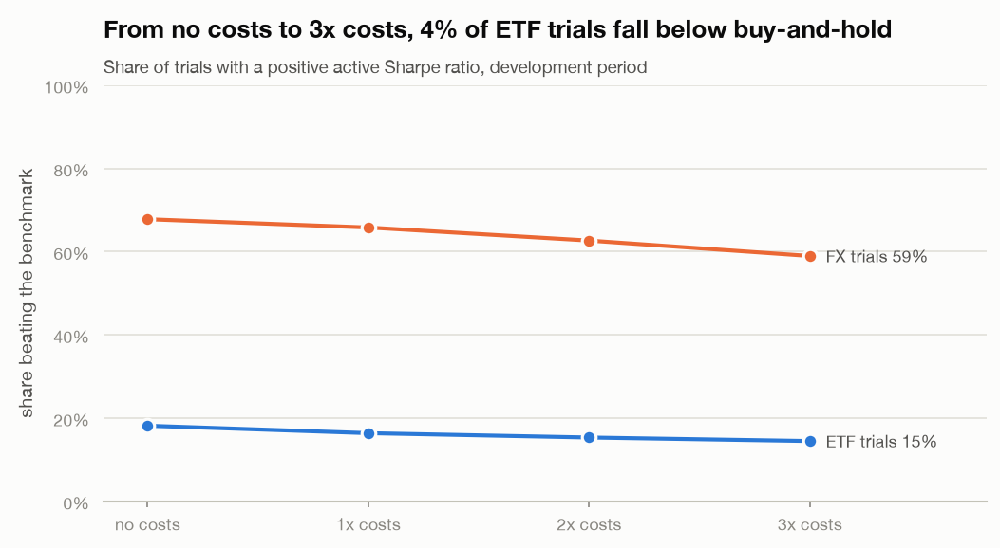</picture>

The ten trials with the highest active Sharpe ratio (annualised; p-values two-sided):

| trial | class | Sharpe (1x) | Sharpe (3x) | p single | p BHY | haircut Sharpe |
|---|---|---|---|---|---|---|
| UNG\|RSI\|period=14,lower=30,upper=70 | etf | 0.65 | 0.65 | 0.016 | 1.00 | 0.00 |
| UNG\|RSI\|period=7,lower=20,upper=80 | etf | 0.65 | 0.64 | 0.017 | 1.00 | 0.00 |
| UNG\|MA crossover\|fast=5,slow=100 | etf | 0.64 | 0.63 | 0.019 | 1.00 | 0.00 |
| UNG\|MA crossover\|fast=50,slow=200 | etf | 0.63 | 0.63 | 0.020 | 1.00 | 0.00 |
| UNG\|channel breakout\|n=50 | etf | 0.62 | 0.62 | 0.022 | 1.00 | 0.00 |
| UNG\|RSI\|period=7,lower=30,upper=70 | etf | 0.61 | 0.60 | 0.024 | 1.00 | 0.00 |
| UNG\|time-series momentum\|lookback=126 | etf | 0.61 | 0.60 | 0.025 | 1.00 | 0.00 |
| UNG\|RSI\|period=14,lower=20,upper=80 | etf | 0.60 | 0.60 | 0.027 | 1.00 | 0.00 |
| UNG\|MA crossover\|fast=20,slow=200 | etf | 0.59 | 0.59 | 0.029 | 1.00 | 0.00 |
| UNG\|time-series momentum\|lookback=63 | etf | 0.59 | 0.57 | 0.030 | 1.00 | 0.00 |

Engine check: 118 randomly chosen trials re-run on the loop
engine; largest NAV gap 4.8e-14.

<!-- PILLAR4:END -->

### Holdout

<!-- PILLAR4_HOLDOUT:START -->
<!-- Generated by `qrf study`. Do not edit by hand. -->

Holdout 2021-12-01 to 2026-11-23, opened once and committed
unchanged (tag `pillar4-holdout-opened`). Generated by commit `c1479b4`;
data through 2026-11-23. Re-running every trial on the full history reproduced
the development returns to within 0e+00, so no holdout data
reached the development results.

**Trials taken forward:** no H2 survivors, so the 10 best development trials. 9 of 10 have a positive active Sharpe
ratio in the holdout; their average falls from 0.62 in development to 0.32.

**Walk-forward picks** (re-choosing the best rule so far each year): positive for
27% of ETFs (median -0.16) and
56% of currencies (median 0.02).

<picture><source media="(prefers-color-scheme: dark)" srcset="reports/pillar4/holdout/figures/holdout-dark.png">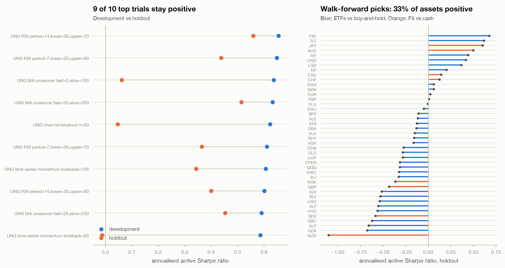</picture>

| trial | development Sharpe | holdout Sharpe | holdout days |
|---|---|---|---|
| UNG\|RSI\|period=14,lower=30,upper=70 | 0.65 | 0.56 | 1250.000 |
| UNG\|RSI\|period=7,lower=20,upper=80 | 0.65 | 0.44 | 1250.000 |
| UNG\|MA crossover\|fast=5,slow=100 | 0.64 | 0.06 | 1250.000 |
| UNG\|MA crossover\|fast=50,slow=200 | 0.63 | 0.51 | 1250.000 |
| UNG\|channel breakout\|n=50 | 0.62 | 0.05 | 1250.000 |
| UNG\|RSI\|period=7,lower=30,upper=70 | 0.61 | 0.36 | 1250.000 |
| UNG\|time-series momentum\|lookback=126 | 0.61 | 0.34 | 1250.000 |
| UNG\|RSI\|period=14,lower=20,upper=80 | 0.60 | 0.40 | 1250.000 |
| UNG\|MA crossover\|fast=20,slow=200 | 0.59 | 0.45 | 1250.000 |
| UNG\|time-series momentum\|lookback=63 | 0.59 | -0.01 | 1250.000 |

Per-asset picks: [`walk_forward.csv`](reports/pillar4/holdout/walk_forward.csv).

<!-- PILLAR4_HOLDOUT:END -->

## Run

```bash
cp .env.example .env          # add FRED_API_KEY and TIINGO_API_KEY (free)
make install
make refresh                  # fetch -> build -> check  (or: uv run qrf refresh)
make test                     # also: make lint, make typecheck
make hooks                    # optional: run the pre-commit checks on every commit
```

Query with SQL:

```python
import duckdb

con = duckdb.connect("data/warehouse.duckdb", read_only=True)
con.sql("SELECT date, value FROM observations WHERE series_id = 'DGS10' ORDER BY date DESC LIMIT 5")
```

## Documentation

- [Pillar 0 write-up](docs/projects/pillar-0/PROJECT.md)
- [Pillar 2 write-up](docs/projects/pillar-2/PROJECT.md)
- [Pillar 5 write-up](docs/projects/pillar-5/PROJECT.md)
- [Pillar 4 write-up](docs/projects/pillar-4/PROJECT.md) and [pre-registration](docs/projects/pillar-4/PREREGISTRATION.md)
- [Backtester design](docs/design/backtester.md)
- [Design docs](docs/design/)
- [Decision records](docs/decisions/)
- [Development log](docs/devlog/)
- [Learning notes](docs/learning/)
- [References](references.bib)
